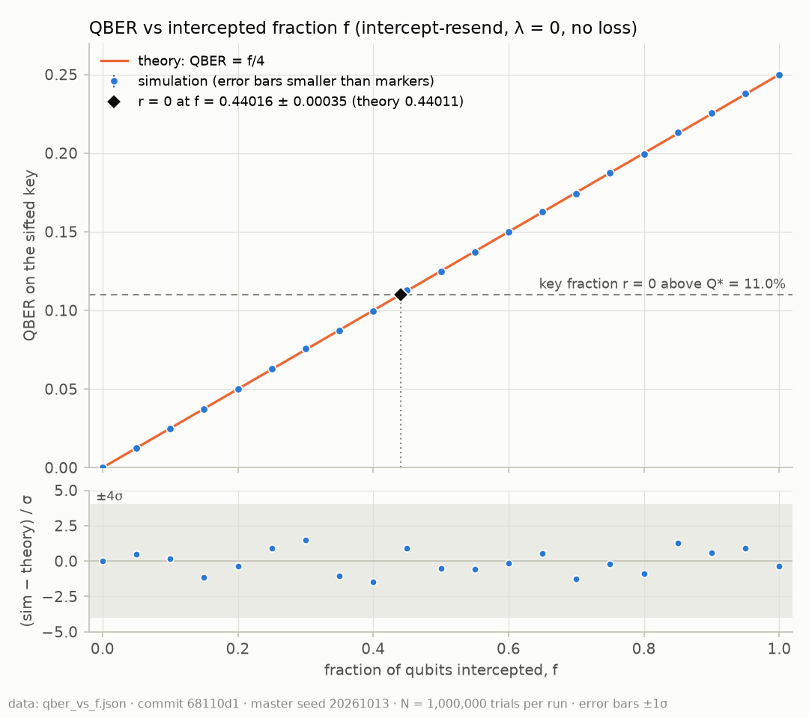
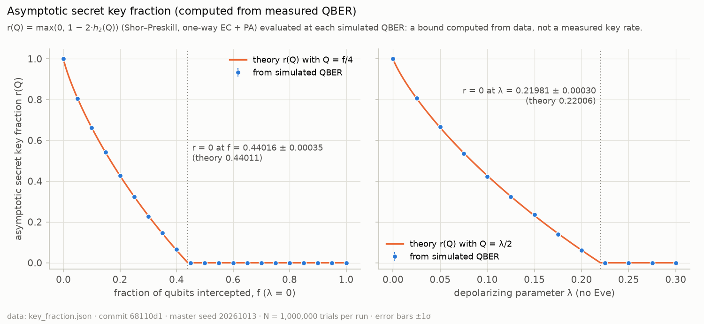
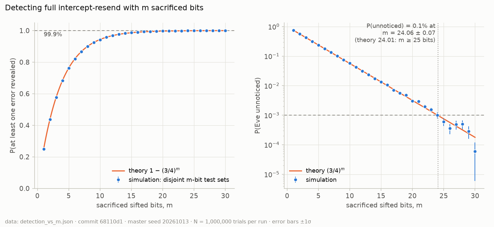

# QKD-Bot — A Simulation Study of BB84 and Intercept-Resend Detection

Classical key exchange rests on computational hardness — we assume factoring large numbers is
too slow to break RSA. Quantum key distribution rests on a different assumption: that measuring
a quantum system disturbs it, so an eavesdropper on the quantum channel is forced to introduce
errors the legitimate parties can detect statistically.

This project studies that mechanism in simulation. Alice and Bob run the BB84 protocol over a
modelled channel with depolarizing noise and loss, simulated with Qiskit Aer. An intercept-resend
attacker acting on a fraction *f* of the qubits drives the quantum bit error rate (QBER) toward its
predicted 25 % signature, which Alice and Bob estimate from a sacrificed subset of their sifted key.
Every measured quantity is compared with its closed-form prediction, with uncertainties.

## Scope — what this is and is not

**This is a simulation study.** There is no optical hardware and no physical quantum channel.
The channel is a software model: qubit states, a configurable loss and noise model, and a
simulated measurement. The no-cloning theorem is therefore **modelled, not demonstrated** — the
project studies the protocol's error statistics and detection behaviour, not the physics itself.

Real QKD deployments require dedicated optical hardware and a fibre or line-of-sight link.
Nothing here claims otherwise, and no application to mobile or field systems is implied.

What the project does offer: a working implementation of sifting (basis reconciliation) and QBER
estimation on a sacrificed subset, a reproducible intercept-resend attacker model, and measured
error statistics compared against theoretical predictions. Every number below can be traced to a
provenance-stamped file in [`results/`](results/).

## Results

All results come from `python scripts/run_sweeps.py`, run on a clean tree with Python 3.11.9,
Qiskit 2.5.2 and Qiskit Aer 0.17.2. The `provenance` block of each JSON names the commit that
produced it and records `git_dirty: false`.

There are 64 sweep points, and each is evaluated on 1 000 000 BB84 trials:
- the QBER at 21 values of *f* and 13 values of λ, each point an independent run with its own seed
  (derived from master seed 20261013 and recorded in the JSON);
- the detection probability at 30 values of *m*, all evaluated on one full-intercept-resend run.

Uncertainties are ±1σ: the binomial standard error, or the fit uncertainty for fitted quantities.
z = (measured − theory) / σ.

### Headline numbers

| Quantity | Measured | Theory | z | Source |
|---|---|---|---|---|
| QBER under full intercept-resend (*f* = 1) | 0.24977 ± 0.00061 | 0.25 | −0.38 | [`qber_vs_f.json`](results/qber_vs_f.json), point *f* = 1.0 |
| Slope of QBER vs *f* (21 values of *f*) | 0.24997 ± 0.00020 | 0.25 | −0.13 | [`qber_vs_f.json`](results/qber_vs_f.json), `fit.k` |
| *f* at which the asymptotic key fraction reaches zero | 0.44016 ± 0.00035 | 0.44011 | +0.13 | [`qber_vs_f.json`](results/qber_vs_f.json), `fit.zero_key_at` |
| Depolarizing λ at which it reaches zero (no Eve) | 0.21981 ± 0.00030 | 0.22006 | −0.84 | [`qber_vs_lambda.json`](results/qber_vs_lambda.json), `fit.zero_key_at` |
| P(Eve unnoticed) with 10 sacrificed bits | 0.0576 ± 0.0010 | 0.0563 | +1.26 | [`detection_vs_m.json`](results/detection_vs_m.json), point *m* = 10 |
| Sacrificed bits for ≥ 99.9 % detection (full Eve) | **25** (continuous solution 24.06 ± 0.07) | **25** (24.01) | +0.77 | [`detection_vs_m.json`](results/detection_vs_m.json), `m_for_target` |
| QBER with no Eve and no noise | 0 errors in 500 056 sifted bits | 0 | exact | [`qber_vs_f.json`](results/qber_vs_f.json), point *f* = 0.0 |

**No measured value is more than 4σ from theory.** The `beyond_4sigma` list is empty in
`qber_vs_f.json`, `qber_vs_lambda.json` and `detection_vs_m.json`.
- **Across the 64 sweep points, the largest deviation of the measured quantity is 2.0σ.** The
  measured quantity is the QBER or the detection probability; the largest deviation is |z| = 2.04,
  for the QBER at λ = 0.15.
- **Each point also records secondary checks:** the sifted fraction, and the QBER estimated on the
  sacrificed subset. The largest of these is 2.7σ (|z| = 2.74, sifted fraction at λ = 0.2).

Twenty-four bits are *not* enough for 99.9 %: with full intercept-resend each sacrificed bit shows
an error with probability 1/4, and with 24 bits Eve still goes unnoticed with probability
0.1003 %, just above 0.1 %.

### QBER vs intercepted fraction



The plot shows 21 values of *f* with 10⁶ trials each, against QBER = *f*/4; the error bars are
smaller than the markers. The dashed line is the threshold Q* = 11.0 % above which the asymptotic
key fraction is zero. The diamond is where the fitted line crosses it. The lower panel shows each
point's deviation in units of σ. Data: [`results/qber_vs_f.json`](results/qber_vs_f.json).

### Asymptotic secret key fraction (computed from measured QBER)



r(Q) = max(0, 1 − 2·h₂(Q)) is the Shor–Preskill bound for one-way error correction and privacy
amplification. It is evaluated at each simulated QBER, with σ by the delta method. This is an
asymptotic bound computed from the measured QBER, **not a measured key rate**: no error correction
or privacy amplification is run. Data: [`results/key_fraction.json`](results/key_fraction.json),
derived only from `qber_vs_f.json` and `qber_vs_lambda.json`.

### Detection probability vs sacrificed bits



The data come from one full intercept-resend run with 500 247 sifted bits. For each *m* = 1 … 30 the
sifted key is shuffled and cut into disjoint *m*-bit test sets. The fraction of sets containing at
least one error is compared with 1 − (3/4)^*m*. Data:
[`results/detection_vs_m.json`](results/detection_vs_m.json).

The derivations, the statistics behind the error bars, and the problems found and investigated
along the way are in [`docs/theory.md`](docs/theory.md) (results: §7; problems: §6).

## How the results are checked

- **Unit tests against theory** ([`tests/`](tests/), `python -m pytest`):
  - the noiseless QBER is *exactly* zero, which catches bit-order bugs
  - full and partial intercept-resend give the predicted QBER
  - depolarizing noise gives λ/2 in both bases
  - Eve and noise combine as predicted
  - loss lowers the sifted fraction without raising the QBER
  - a seed reproduces a run exactly
  - the detection probability follows (3/4)^*m*

  Statistical checks use a 4σ tolerance with σ = √(q(1−q)/n), never a fixed loose window.
- **Provenance.** Every results file records the git commit, whether the code differed from it, the
  Python, Qiskit, Aer and NumPy versions, the seeds and N. Plots are drawn from the JSON files, never
  from in-memory state.
- **Reproducibility.** Rerunning the sweep on the committed code reproduces every number exactly;
  only the provenance block changes ([`docs/devlog.md`](docs/devlog.md)).

## Reproduce

```powershell
py -3.11 -m venv .venv
.\.venv\Scripts\Activate.ps1
pip install -e ".[dev]"
python -m pytest -q
python scripts/run_sweeps.py               # regenerates results/*.json and the plots (several minutes)
python scripts/run_sweeps.py --plots-only  # redraws the plots from the existing JSON
```

## Limits

- **Simulation only.** No optical hardware and no physical channel. The qubits are simulated on a
  classical computer, and the no-cloning theorem and measurement disturbance are *modelled*: they
  are built into what the simulated eavesdropper can do. They are not demonstrated.
- **Ideal single-photon source.** No multi-photon pulses, so no photon-number-splitting attack and no
  decoy states.
- **Asymptotic key fraction, not composable finite-key security.** The key fraction is the asymptotic
  Shor–Preskill bound evaluated at the measured QBER. Error correction and privacy amplification are
  not implemented, only their cost enters, and there are no finite-size corrections.
- **One attack.** Only intercept-resend on a fraction *f* of the qubits, placed before the channel
  noise. Optimal individual attacks, collective and coherent attacks are not modelled.
- **Idealised channel and detectors.** Depolarizing noise only. Loss is an ideal erasure that Bob
  always notices. There are no dark counts, no detector efficiency mismatch and no blinding.
- **Classical channel.** BB84 needs an authenticated classical channel; it is assumed, not modelled.
- **Detection rule.** The detection plot uses the idealised noiseless rule "any error in the test
  bits means Eve". With channel noise, the real decision is whether the estimated QBER exceeds a
  threshold.
- **Statistics.** Uncertainties are binomial standard errors. At the largest *m* in the detection
  plot fewer than ten undetected test sets are expected, so the normal approximation behind those
  error bars is rough.
- **No deployment claims.** Nothing here is a statement about a physical QKD system, field use or
  robotics, and nothing is "secured by physics".

## Core technologies

- **Language:** Python 3.11
- **Quantum simulation:** Qiskit with the Qiskit Aer stabilizer simulator. Each distinct one-qubit
  BB84 circuit is simulated once, with one shot per trial that shares its configuration.
- **Numerics and statistics:** NumPy, for seeded sampling, sifting, binomial uncertainties and
  weighted fits
- **Plots:** Matplotlib, drawn from the JSON results only
- **Tests:** pytest, against closed-form theory with 4σ tolerances

## Roadmap to MVP — complete

### Phase 1 — BB84 core
- [x] Single-process BB84: random bit and basis preparation, random-basis measurement, sifting on
      matching bases, QBER estimation over a sacrificed subset
- [x] Channel model: depolarizing noise and loss
- [x] Intercept-resend attacker on a configurable fraction *f* of the qubits
- [x] Tests against theory: exact-zero noiseless QBER, 25 % under full intercept-resend, *f*/4,
      λ/2 in both bases, combined Eve and noise, sifted fraction with and without loss,
      reproducibility, detection probability (3/4)^*m*

### Phase 2 — Sweeps and evaluation
- [x] Sweeps of QBER vs *f* and vs λ, and of detection vs *m*, written to provenance-stamped JSON
- [x] Three plots drawn from the JSON: QBER vs *f*; asymptotic secret key fraction vs *f* and λ;
      detection probability vs *m*
- [x] Every comparison with theory checked at 4σ; none beyond it

### Phase 3 — Documentation
- [x] Results and Limits in this README
- [x] Theory notes: [`docs/theory.md`](docs/theory.md)
- [x] Development log: [`docs/devlog.md`](docs/devlog.md)

## Definition of done

`python -m pytest` passes. `python scripts/run_sweeps.py` regenerates `results/` from the recorded
seeds with identical numbers. Every number in this README traces to a file in `results/`. The
measured QBER and detection curves agree with theory within 4σ.

## Current status

MVP complete on 2026-10-25. See [`docs/devlog.md`](docs/devlog.md).

## Planned extensions

None of these has been started. They are listed so the boundaries of the MVP are explicit.

- **Distributed nodes:** Alice, Bob and Eve as separate processes in Docker Compose, with a
  WebSocket channel carrying the simulated quantum states and UDP for classical reconciliation
- **Fail-safe logic:** automatic key rejection, with logging, when the estimated QBER exceeds the
  threshold
- **Post-processing:** Cascade error correction and privacy amplification via universal hashing, to
  produce an actual secret key and a measured key rate to set against the asymptotic bound
- **Symmetric encryption:** AES-GCM keyed from that distilled key. QKD distributes a key; symmetric
  cryptography does the encryption.
- **E91**, the entanglement-based protocol
- **ROS2 interface:** a software integration only, with no robotics or field-deployment claim
- **Beyond the ideal model:** decoy states against photon-number splitting, detector imperfections,
  and finite-key analysis
