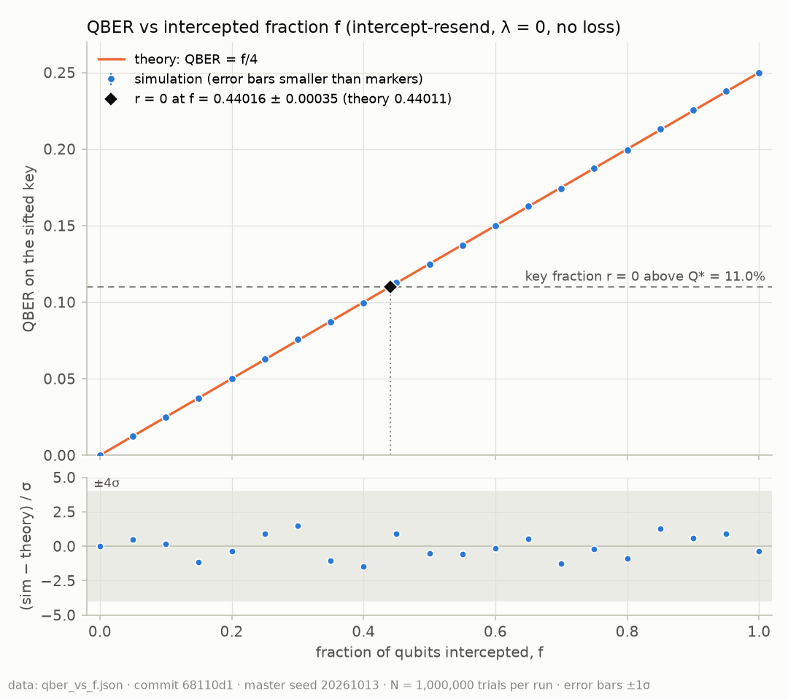
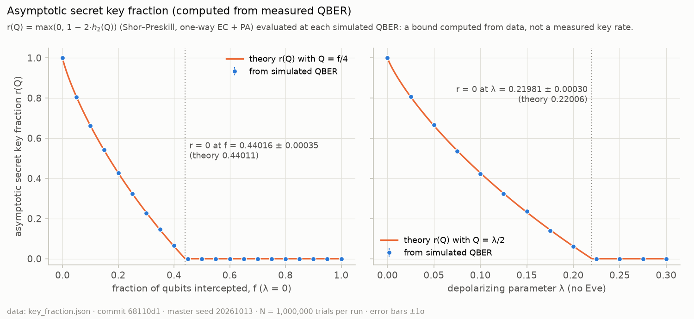
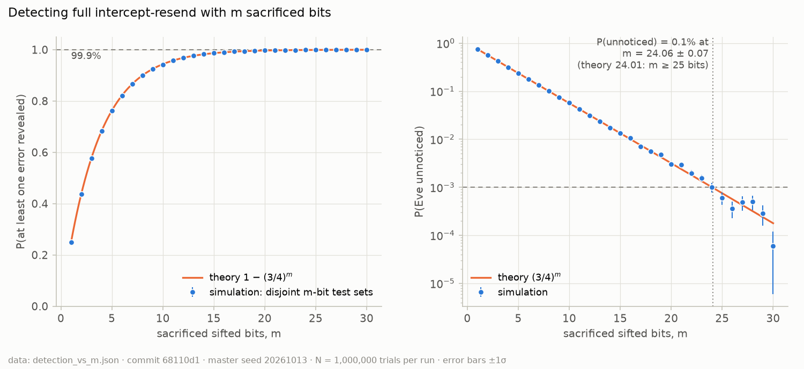

# BB84 — theory notes

*Written 2026-10-12 to 2026-11-15 over three stages: Stage 1 built the core and the tests, Stage 2
the sweeps and plots, Stage 3 the documentation ([devlog](devlog.md)). Covers what is implemented
in `src/qkd_bot/`: the closed-form predictions (`theory.py`), the simulated protocol (`circuits.py`,
`protocol.py`), the tests that compare them, and the parameter sweeps (`scripts/run_sweeps.py` →
`results/`). The [README](../README.md) has the short version: results, limits and how to
reproduce them.*

> **This is a simulation.** The qubits are simulated by Qiskit Aer on a classical computer. The
> no-cloning theorem and the disturbance caused by measurement are *modelled* — they are built
> into the rules the simulated eavesdropper has to follow — not demonstrated. Nothing here is a
> claim about a physical QKD system.

## Contents

1. [Notions you need](#1-notions-you-need)
2. [The protocol as simulated](#2-the-protocol-as-simulated)
3. [Theory, row by row](#3-theory-row-by-row)
4. [How the simulation works](#4-how-the-simulation-works)
5. [Statistics: what "agrees with theory" means](#5-statistics-what-agrees-with-theory-means)
6. [Problems found and how they were solved](#6-problems-found-and-how-they-were-solved)
7. [Results: the three plots](#7-results-the-three-plots) —
   [plot 1, QBER vs f](#plot-1) ·
   [plot 2, key fraction](#plot-2) ·
   [plot 3, detection vs m](#plot-3)
8. [Questions this project answers](#8-questions-this-project-answers)

---

## 1. Notions you need

### Qubit

A qubit's state is a unit vector |ψ⟩ = α|0⟩ + β|1⟩ with complex amplitudes α, β and
|α|² + |β|² = 1. In BB84 the qubit is, physically, the polarisation of a single photon; here it is
a simulated two-level system.

### The two BB84 bases

A *basis* is a pair of perfectly distinguishable states. BB84 uses two:

| Basis | Bit 0 | Bit 1 |
|---|---|---|
| **Z** (rectilinear) | \|0⟩ | \|1⟩ |
| **X** (diagonal) | \|+⟩ = (\|0⟩ + \|1⟩)/√2 | \|−⟩ = (\|0⟩ − \|1⟩)/√2 |

The two bases are **mutually unbiased**: every state of one has the same overlap with both states
of the other, |⟨0|+⟩|² = |⟨1|+⟩|² = 1/2. Knowing a qubit is in the X basis tells you nothing about
what a Z measurement will return.

### Measurement: the Born rule and collapse

Measuring |ψ⟩ in a basis {|k⟩} returns outcome k with probability

$$P(k) = |\langle k|\psi\rangle|^2,$$

and afterwards the qubit **is** |k⟩ — the original state is gone (*collapse*). The whole protocol
follows from two cases:

- **Same basis**: measuring |+⟩ in X returns "+" with certainty.
- **Other basis**: measuring |+⟩ in Z returns 0 or 1 with probability 1/2 each, and leaves |0⟩ or
  |1⟩ behind. The information about "+" is destroyed.

### Gates used

| Gate | Action | Used for |
|---|---|---|
| X | \|0⟩ ↔ \|1⟩ | Alice encodes bit 1 |
| H (Hadamard) | \|0⟩ → \|+⟩, \|1⟩ → \|−⟩, and back (H·H = I) | moving into and out of the X basis |

Simulators (and most hardware) measure only in Z. **Measuring in X = apply H, then measure in Z.**

### Density matrix and the maximally mixed state

Noise turns a definite state into a probabilistic mixture, which a state vector cannot describe.
A density matrix can: ρ = Σᵢ pᵢ |ψᵢ⟩⟨ψᵢ|, with P(k) = ⟨k|ρ|k⟩. For a definite state,
ρ = |ψ⟩⟨ψ|. The **maximally mixed state** ρ = I/2 gives P(k) = 1/2 for every k in every basis:
a fair coin whatever you measure.

### Pauli operators

X (bit flip), Z (phase flip) and Y = iXZ (both). How they act on the BB84 states:

| | on Z-basis states | on X-basis states |
|---|---|---|
| X | flips the bit | no change (up to a sign) |
| Y | flips the bit | flips the bit |
| Z | no change (up to a sign) | flips the bit (\|+⟩ ↔ \|−⟩) |

So in **either** basis, exactly two of the three Paulis flip the bit.

### Quantum channel

Any physically allowed transformation of ρ. The noisy fibre is modelled by the **depolarizing
channel** E(ρ) = (1 − λ)ρ + λ·I/2: with probability λ the qubit is replaced by a fair coin.

### No-cloning theorem

No physical process copies an unknown quantum state: there is no operation U with
U|ψ⟩|0⟩ = |ψ⟩|ψ⟩ for every |ψ⟩. So Eve cannot keep a copy of the photon and measure it later,
after the bases are announced. She has to act on the single qubit in flight, without knowing its
basis. **In this repository this is modelled**: the simulated Eve is only given measure-and-resend.
The theorem itself is not tested.

### Protocol vocabulary

- **Raw key** — Alice's bits for every qubit sent.
- **Sifting** — Alice and Bob publicly announce their *bases* (never their bits) and keep only the
  positions where the bases match.
- **Sifted key** — what is left after sifting.
- **QBER** (quantum bit error rate) — the fraction of sifted positions where Alice's and Bob's bits
  differ.
- **Sacrificed (test) bits** — a random subset of the sifted key that is revealed publicly to
  estimate the QBER, then discarded.
- **Loss** — the photon never arrives; Bob's detector does not click, and Bob knows it.
- **Intercept-resend** — Eve measures a qubit in a basis she guesses at random and sends Bob a
  fresh qubit in the state she observed.
- **Binary entropy** — h₂(Q) = −Q log₂ Q − (1 − Q) log₂(1 − Q): the information, in bits, in one
  outcome of a coin that comes up "error" with probability Q. h₂(0) = 0, h₂(1/2) = 1.
- **Error correction (EC)** and **privacy amplification (PA)** — the classical post-processing that
  turns the sifted key into identical (EC) and secret (PA) keys. Neither is implemented here (they
  are planned extensions); only their *cost* enters, through the key fraction r(Q).

---

## 2. The protocol as simulated

For each of N trials:

1. Alice picks a random bit *a* and a random basis α ∈ {Z, X} and prepares the qubit.
2. With probability *f*, Eve intercepts: she picks a random basis ε, measures, and resends what she
   saw.
3. The channel applies depolarizing noise λ. With probability L the qubit is lost.
4. Bob picks a random basis β and measures, getting *b*.
5. **Sifting**: keep the trials that arrived and where α = β.
6. **Sacrifice**: each sifted bit is revealed with probability `test_fraction` (default 10 %); the
   error rate on those bits is the QBER *estimate*.

As a circuit (`circuits.bb84_circuit`):

```
        Alice                 Eve (only if intercepted)        channel        Bob
|0> ─[X if a=1]─[H if α=X]─[H if ε=X]─[measure→eve]─[H if ε=X]─[depol λ]─[H if β=X]─[measure→bob]
```

Because this is a simulation, `BB84Run` also knows the QBER over the *whole* sifted key
(`qber`). Alice and Bob in a real run only see `qber_estimate`.

---

## 3. Theory, row by row

### 3.1 Sifting — sifted fraction = (1 − L)/2

Bob chooses his basis independently of Alice and uniformly, so their bases agree with probability
1/2. When they disagree, Bob measures in the basis mutually unbiased to Alice's and gets a fair
coin, uncorrelated with her bit, so that position carries no key and is dropped. Loss removes a
further fraction L before anything is compared, independently of the bases.

$$\text{sifted fraction} = \frac{1 - L}{2}$$

**Validated by:** `test_sifted_fraction_is_one_half`,
`test_loss_lowers_the_sifted_fraction_not_the_qber`; the sifted fraction recorded, with its z
against 1/2, at all 34 sweep points (`sifted_fraction_z` in `results/qber_vs_f.json` and
`results/qber_vs_lambda.json`).

<a id="full-intercept-resend"></a>

### 3.2 Full intercept-resend — QBER = 1/4

Look only at sifted positions, where Bob uses Alice's basis. Eve does not know that basis. With
probability 1/2 she guesses it: she reads Alice's bit exactly and resends exactly Alice's state, so
Bob sees no error. With probability 1/2 she guesses wrong: her measurement collapses the qubit into
a state of the *other* basis, which is what she resends; Bob measures it in Alice's basis and gets a
fair coin, an error with probability 1/2. Eve's guess is the only thing she can do wrong, and she
cannot know whether she did.

$$\text{QBER} = \tfrac12 \cdot 0 + \tfrac12 \cdot \tfrac12 = \tfrac14$$

**Validated by:** `test_qber_matches_theory[1.0-0.0-0.25]`; [plot 1](#plot-1) at f = 1.

<a id="partial-interception"></a>

### 3.3 Partial interception — QBER = f/4

If Eve intercepts each qubit independently with probability *f*, the intercepted sifted positions
have error rate 1/4 (§3.2) and the others have none. Sifting does not depend on whether Eve acted,
so the intercepted fraction of the sifted key is still *f*.

$$\text{QBER} = f \cdot \tfrac14$$

**Validated by:** `test_qber_matches_theory[0.4-0.0-0.1]`; [plot 1](#plot-1), all 21 points of
the f sweep.

<a id="depolarizing"></a>

### 3.4 Depolarizing channel — QBER = λ/2, in both bases

With probability 1 − λ the qubit passes untouched; with probability λ it becomes I/2, a fair coin
in any basis, which is wrong half the time. The same result in Pauli form makes the "both bases"
claim visible. Any single-qubit ρ satisfies I/2 = (ρ + XρX + YρY + ZρZ)/4, so

$$(1-\lambda)\rho + \lambda\frac{I}{2} = \left(1 - \tfrac{3\lambda}{4}\right)\rho + \tfrac{\lambda}{4}\left(X\rho X + Y\rho Y + Z\rho Z\right):$$

each Pauli occurs with probability λ/4. In either basis exactly two of the three Paulis flip the bit
(§1), so the flip probability is 2 · λ/4 in Z and in X.

$$\text{QBER} = \frac{\lambda}{2}$$

Qiskit Aer's `depolarizing_error(λ, 1)` uses exactly this λ (identity with probability 1 − 3λ/4,
each Pauli λ/4; checked in the qiskit-aer 0.17.2 source, see §6.2).

**Validated by:** `test_qber_matches_theory[0.0-0.1-0.05]`,
`test_depolarizing_qber_is_lambda_over_two_in_each_basis[0]` (Z) and `[1]` (X); the 13-point λ
sweep in `results/qber_vs_lambda.json`, shown through r(Q) in the right panel of
[plot 2](#plot-2).

### 3.5 Eve and noise together — QBER = f/4 + λ/2 − fλ/4

In this model Eve sits at Alice's output and the noisy channel comes after her. Split the sifted
positions three ways. Not intercepted (1 − *f*): only noise, error λ/2. Intercepted with the right
basis (*f*/2): Eve resends the correct state, then noise, error λ/2. Intercepted with the wrong basis
(*f*/2): Bob's outcome is already a fair coin, and depolarizing a state that is unbiased in Bob's
basis leaves it unbiased, so the error stays 1/2 — the noise adds nothing. Adding up:

$$\text{QBER} = (1-f)\frac{\lambda}{2} + \frac f2\cdot\frac{\lambda}{2} + \frac f2\cdot\frac12 = \frac f4 + \frac{\lambda}{2} - \frac{f\lambda}{4}$$

The −*f*λ/4 term is the overlap: noise that falls on an already randomised bit is not counted twice.

**Validated by:** `test_qber_matches_theory[0.4-0.1-0.14]`.

<a id="key-fraction"></a>

### 3.6 Asymptotic secret key fraction — r(Q) = max(0, 1 − 2·h₂(Q))

After sifting, Alice's and Bob's keys differ in a fraction Q of positions, and Eve may know
something about them. Two costs follow. **Error correction**: to make the keys identical, Alice must
send Bob at least h₂(Q) bits of parity information per key bit (the Shannon limit for errors of rate
Q), and Eve hears all of it. **Privacy amplification**: Eve's information is bounded by the *phase*
error rate; in BB84 that rate is estimated by the bit error rate in the other basis, and with
symmetric errors (as in this model) it is also Q, so another h₂(Q) bits per bit must be hashed
away. What remains per sifted bit is r(Q) (Shor and Preskill, 2000, for one-way EC and PA). It is
**asymptotic**: infinitely long keys, error correction exactly at the Shannon limit, no finite-size
statistical penalty. It is a bound computed from a QBER, not a measured key rate.

$$r(Q) = \max\bigl(0,\; 1 - 2\,h_2(Q)\bigr), \qquad h_2(Q) = -Q\log_2 Q - (1-Q)\log_2(1-Q)$$

**Validated by:** `test_binary_entropy_is_one_bit_at_one_half`,
`test_binary_entropy_is_zero_for_a_certain_outcome`, `test_key_fraction_is_one_without_errors`;
[plot 2](#plot-2) (r computed from every simulated QBER, against the theory curve).

<a id="threshold"></a>

### 3.7 Threshold — r = 0 at Q ≈ 11.00 %

The key fraction is positive while each of the two costs is below half a bit. It vanishes when
h₂(Q) = 1/2. h₂ increases on [0, 1/2], so there is a single root, found by bisection in
`theory.qber_threshold`. Above it, no key can be distilled with one-way post-processing and the run
must be aborted.

$$h_2(Q^*) = \tfrac12 \;\Rightarrow\; Q^* \approx 0.110028$$

**Validated by:** `test_key_fraction_reaches_zero_at_eleven_percent`; the horizontal line in
[plot 1](#plot-1) and the zero crossings in [plot 2](#plot-2).

<a id="f-max"></a>

### 3.8 Maximum tolerable interception — f_max ≈ 0.44 (noiseless)

Without noise, Eve's interception is the only source of error, QBER = *f*/4 (§3.3). Setting this
equal to the threshold gives the largest fraction Eve can intercept before the key fraction drops
to zero. With noise, solving f/4 + λ/2 − fλ/4 = Q* gives the general form used in `theory.f_max`.

$$f_{\max} = 4\,Q^* \approx 0.4401 \qquad\text{(general: } f_{\max} = \tfrac{4Q^* - 2\lambda}{1 - \lambda}\text{)}$$

**Validated by:** `test_max_tolerable_interception_noiseless`; the diamond marker in
[plot 1](#plot-1) and the left panel of [plot 2](#plot-2), where f at r = 0 is measured from the
simulated QBER.

<a id="detection"></a>

### 3.9 Detection with m sacrificed bits — P(Eve unnoticed) = (3/4)^m

Under full intercept-resend, each sifted bit is wrong with probability 1/4, independently of the
others (§3.2). Alice and Bob reveal *m* random sifted bits and compare them. Eve escapes only if
all *m* agree, so the probability falls exponentially: *m* = 10 gives 5.6 %, *m* = 24 gives
0.10 %, *m* = 50 gives 6 × 10⁻⁷. This is the idealised, noiseless rule "any error means Eve". With
channel noise there are errors anyway, and the real decision is whether the estimated QBER is above
the threshold.

$$P(\text{unnoticed}) = \left(\tfrac34\right)^m, \qquad P(\text{detect}) = 1 - \left(\tfrac34\right)^m$$

**Validated by:** `test_full_eve_unnoticed_by_24_test_bits` (closed form) and
`test_full_eve_goes_unnoticed_in_ten_test_bits_with_prob_three_quarters_to_the_tenth` (simulated,
*m* = 10, expected 0.0563); [plot 3](#plot-3), *m* = 1 to 30.

### 3.10 Loss is not error

Loss and noise are both channel imperfections, but they act differently. A lost photon produces no
click; Bob announces which trials he received and the rest are removed before sifting, so they never
enter the error count. Loss therefore scales the sifted fraction by (1 − L) and leaves the QBER
untouched. Noise lets the photon arrive in the wrong state, which Bob cannot tell, so it shows up as
errors. This clean separation holds in the ideal model only: real detectors have dark counts (false
clicks, which add errors when the signal is weak) and real sources sometimes emit two photons,
which lets Eve exploit loss (the photon-number-splitting attack). Neither is modelled here.

$$\text{sifted fraction} \propto (1 - L), \qquad \text{QBER independent of } L$$

**Validated by:** `test_loss_lowers_the_sifted_fraction_not_the_qber` (sifted fraction 0.25 at
L = 0.5, QBER exactly 0).

---

## 4. How the simulation works

### 4.1 Twenty-four circuits instead of N

Every trial is fully specified by `(alice_bit, alice_basis, eve_basis, bob_basis)`, with
`eve_basis ∈ {none, Z, X}`: 2 · 2 · 3 · 2 = 24 possible circuits. `run_bb84` therefore:

1. draws every trial's configuration with one seeded NumPy generator,
2. groups the trials by configuration,
3. runs each circuit **once** with `shots` = the size of its group and `memory=True` (one outcome
   per shot),
4. writes the outcomes back to the trials of that group.

This is exact, not an approximation. Each shot is an independent run of the same circuit (checked
for Aer in §6.5), and trials with the same configuration are interchangeable, so which shot goes to
which trial does not matter.
Lost trials are never simulated: nothing reaches Bob.

### 4.2 Why Eve needs no reset and no conditional gate

Eve's measurement collapses the qubit into the basis state she observed, which is exactly the state
she would prepare and resend. The circuit therefore just measures mid-circuit and lets the qubit
continue. For an X-basis interception: H, measure, H — the second H turns the collapsed |0⟩ or |1⟩
back into |+⟩ or |−⟩.

### 4.3 Reading results: Qiskit's bit order

Aer returns each shot as a string such as `'0 1'`: the classical registers, separated by spaces,
**last-declared register first** (Qiskit is little-endian: classical bit 0 is the rightmost
character). The circuits declare `eve` then `bob`, so the *left* character is Bob's.
`circuits.read_register` looks the column up by register name instead of assuming it. See §6.1.

### 4.4 Seeds and reproducibility

One integer seed creates the NumPy generator, which draws, in a fixed order: every trial's bit and
bases, the interception decisions and Eve's bases, the losses, one 62-bit simulator base seed, and
the test-bit selection. The same seed reproduces the run exactly (tested). Three consequences:

- **Aer's random numbers are seeded per shot.** Aer seeds shot *i* of a job with
  `seed_simulator + i`, so a job consumes the seed range [seed, seed + shots). Two jobs whose
  ranges overlap replay the same random numbers (§6.5). `run_bb84` therefore gives its circuits
  **consecutive, disjoint** ranges starting at the random base: no two shots of a run share a seed,
  and two runs collide with probability about 2n/2⁶² (≈ 4 × 10⁻¹³ at n = 10⁶).
  `test_aer_seeds_shot_i_with_seed_plus_i` (in `tests/test_aer_seeding.py`) pins down this Aer
  behaviour.
- **Common random numbers when a seed is reused.** All draws happen whatever *f*, λ and L are, so
  runs with the *same* seed and different parameters share Alice's bits and bases. The tests do
  this deliberately (one seed), so their deviations are correlated (§6.4).
- **Independent sweep points.** `scripts/run_sweeps.py` does the opposite for the QBER sweeps: every
  point (21 values of *f*, 13 of λ) is its own run with its own seed, drawn from one master seed and
  recorded in the JSON. The points of a sweep are therefore statistically independent, and a fit
  across them has honest uncertainties. §6.5 shows this was checked, not assumed. The 30 detection
  points are different: they are all evaluated on one full-intercept-resend run, cut into test sets
  of each size *m*. Each point's own σ is valid, but the points are correlated with each other, and
  no fit is made across them.

### 4.5 Why a classical computer can simulate this efficiently

BB84 uses only stabilizer states (|0⟩, |1⟩, |±⟩), Clifford gates (X, H), measurements in Pauli bases
and Pauli noise (the depolarizing channel is a random Pauli, §3.4). The **Gottesman–Knill theorem**
says such circuits can be simulated classically in polynomial time by tracking a small set of
stabilizer generators instead of 2ⁿ amplitudes; Aer's `method="stabilizer"` does exactly this. With
one qubit any method would be fast; the point is conceptual. BB84's security does not rest on
computational hardness, so being easy to simulate does not weaken it. It rests on Eve not knowing
the basis.

---

## 5. Statistics: what "agrees with theory" means

A measured QBER is a proportion: errors counted over *n* independent sifted bits. Its standard
deviation is

$$\sigma = \sqrt{\frac{q(1-q)}{n}},$$

with *q* the **theoretical** value, so the tolerance does not depend on the measurement it judges.
A test passes when |measured − theory| ≤ 4σ.

- **Why 4σ, not a fixed ±0.05.** At q = 0.25 with n ≈ 100 000 sifted bits, σ ≈ 0.0014 and
  4σ ≈ 0.0055. A ±0.05 window would accept 0.20 for a predicted 0.25 and let a broken simulation
  pass. At 4σ a correct simulation fails by chance with probability about 6 × 10⁻⁵ per check.
- **The right n.** The sifted fraction uses n = N trials; a QBER uses n = sifted bits; the
  per-basis check uses only that basis's bits; the subset estimate uses the number of test bits.
- **Fixed seed.** Each test is deterministic: it passes or fails the same way every time.
- **Disjoint blocks for detection.** `detection_rate` shuffles the sifted key and cuts it into
  disjoint *m*-bit blocks. Each block is then a fresh set of independent bits, the blocks are
  independent of each other, and the binomial σ for the number of blocks is the honest uncertainty.
  Resampling overlapping subsets would reuse the same bits and understate it.
- **More than 4σ off** is reported and investigated, never tuned away.

---

## 6. Problems found and how they were solved

Stage 1, 2026-10-12. Environment: Python 3.11.9, qiskit 2.5.2, qiskit-aer 0.17.2, numpy 2.4.6.

### 6.1 Qiskit's bit order could silently swap Eve's and Bob's bits

**Problem.** Before writing `circuits.py`, a probe circuit was run in which Eve measures 1 and Bob
measures 0, with registers declared in the order (eve, bob). Aer returned `'0 1'` for every shot:
Bob's register is on the **left**. The natural guess, "the last character is my result", would have
returned Eve's bit as Bob's.

**Why it matters.** With full interception, Eve's bit disagrees with Alice's on the sifted key 1/4 of
the time, the same as Bob's should. A swap would therefore have passed the full-Eve test while
measuring the wrong party.

**Solution.** Registers are named, and `read_register` finds the column by name. Eve's register is
declared in *every* circuit, even without Eve, where it always reads 0. The layout never changes, and
a swap now makes the noiseless QBER about 1/2 (Alice's random bits against constant zeros), so the
exact-zero test would fail loudly.

### 6.2 Two conventions for "depolarizing probability"

**Problem.** The literature uses two parameterisations: λ, the weight of I/2 (used here), and *p*,
the total probability of a Pauli error, with p = 3λ/4 and QBER = 2p/3. Passing a value in the wrong
convention gives a QBER of 0.0375 or 0.0667 instead of 0.05 at λ = 0.1, 18 to 24σ off at the test
size.

**Solution.** The source of `qiskit_aer.noise.depolarizing_error` (0.17.2) was read before any noise
code was written. It defines E(ρ) = (1 − λ)ρ + λ·I/2 and builds identity with probability
1 − 3λ/4 and each Pauli with λ/4, the same convention as §3.4. No rescaling was needed. A per-basis
test guards the "both bases" claim. A probe on |0⟩ with λ = 0.2 gave a flip rate of 0.1003
(expected 0.1).

### 6.3 Transpiling was 70 % of the run time

**Problem.** The first `run_bb84` called `transpile` once per circuit. Profiling one
200 000-trial run (f = 0.4, λ = 0.1) showed 11.2 s of 16.4 s spent in `transpile`: Aer rebuilds its
whole backend description (the `Target`) on every call, about 0.45 s each, 24 times.

**Solution.** All 24 circuits are transpiled in a single call, still with `optimization_level=0` so
the explicit noise instruction is kept. The same run dropped from 14.2 s to 4.2 s (10⁶ trials:
about 18 s). The output is bit-for-bit identical: same seed, same QBER to every digit.

### 6.4 A 2.6σ deviation, investigated rather than ignored

**Observation.** With N = 200 000 and seed 20261012, the Z-basis QBER for λ = 0.1 came out at
0.05257 against 0.05, z = +2.63, inside the 4σ tolerance but the largest of the 10 statistical
checks.

**Investigation.** One check in 10 at that size is expected by chance roughly one time in twelve
(P(|z| > 2.63) ≈ 0.0085 per check), but a
systematic Z-basis bias would be a real bug (for example, a convention error affecting only one
basis). The same check was rerun at 10⁶ trials with three fresh seeds:

```python
from qkd_bot.circuits import Z
from qkd_bot.protocol import run_bb84
for seed in (1, 2, 3):
    r = run_bb84(1_000_000, lam=0.1, seed=seed)
    print(seed, r.errors[r.key_bases == Z].mean())
```

| seed | Z-basis QBER | z | X-basis QBER | z |
|---|---|---|---|---|
| 1 | 0.05037 | +0.84 | 0.04999 | −0.03 |
| 2 | 0.05017 | +0.40 | 0.04935 | −1.48 |
| 3 | 0.05005 | +0.11 | 0.05036 | +0.82 |

**Conclusion.** No bias. The +2.63 was a statistical fluctuation, and nothing was changed. The λ = 0.1
and *f* = 0.4, λ = 0.1 runs in the tests share a seed, and therefore Alice's bits, bases and the
simulator seeds (§4.4), so their positive deviations (+1.72σ and +2.21σ) are not two independent
pieces of evidence.

*All numbers in this subsection come from the Stage 1 seeding scheme, before the §6.5 fix. The fix
changes which random numbers every run draws, so rerunning the tests or the snippet today gives
different z-scores, which are equally valid.*

### 6.5 Aer replays random numbers when seed ranges overlap

Stage 2, 2026-10-13.

**Observation.** In the first full sweep, the fit of QBER = k·f over 20 points (§7, plot 1) had
χ² = 8.0 for 19 degrees of freedom. The points scattered *less* than binomial statistics allow:
lower-tail probability ≈ 1 %. No single point was beyond 4σ, so per-point z-scores could not reveal
it. But underdispersion would mean the error bars, or the claimed independence of the sweep points,
are wrong.

**Investigation.**

1. **Dispersion test.** One circuit whose outcome is a fair coin (Eve in the wrong basis) was run as
   300 jobs of 10 000 shots with seeds 10 000, 10 001, … The variance of the counts between jobs
   came out at **0.016×** the binomial value, 12σ below 1.
2. **Cause of the test result.** The job with seed s + 1 returns *exactly* the job with seed s,
   shifted by one shot. Aer seeds shot *i* with `seed_simulator + i`, so a job consumes the seed
   range [seed, seed + shots). The 300 test jobs were near-copies of each other, so the test's own
   consecutive seeds produced result 1.
3. **Shots within one job are independent.** In a single 10⁶-shot job, the block-count variance
   ratios (blocks of 100, 1 000 and 10 000) and the lag-1, 2, 3 and 10 autocorrelations were all
   within |z| ≤ 2.2, for both the Eve circuit and the depolarizing circuit. So each point's own σ
   was sound.
4. **But the jobs of different runs did overlap.** The Stage 1 `run_bb84` drew its 24 circuit seeds
   uniformly from [0, 2³¹). Replaying all 35 runs of that first sweep (600 Aer jobs, 3.5 × 10⁷
   shots) found no overlap *inside* any run, but **9 pairs of jobs in different sweep points
   overlapped**. They shared up to 77 014 shots, and in two pairs 100 % of the smaller job. Those
   sweep points were not independent, contrary to what the sweep claimed. Overlaps between runs do
   not change any single point's variance, so they do not by themselves explain the low χ². That
   value is consistent with chance; see the conclusion.

**Fix.** Each run now draws one random 62-bit base and gives its circuits consecutive, disjoint seed
ranges (§4.4). Aer was checked to keep 62-bit seeds distinct (seeds 2³² and 2⁴⁰ apart give unrelated
streams, agreement 0.504 and 0.497) and to keep the seed + i rule there.
`test_aer_seeds_shot_i_with_seed_plus_i` (in `tests/test_aer_seeding.py`) pins down both facts. All
24 tests pass on the new streams: the 23 checks against theory, plus that one simulator-behaviour
test.

**Conclusion.** The whole sweep was regenerated with the fixed code. A replay of its seeds confirms
that the 35 runs' ranges are pairwise disjoint, with a smallest gap of 9.3 × 10¹⁴ seeds. The same
fit now gives χ² = 15.0 for 19 degrees of freedom, so the earlier 8.0 is consistent with chance. The
superseded results were never committed, and nothing in them was adjusted; they were replaced by a
run of the corrected code.

---

## 7. Results: the three plots

Produced by `python scripts/run_sweeps.py` on a clean tree. Every run has N = 10⁶ trials, with no
loss and a test fraction of 10 %. There are 64 sweep points, each evaluated on 10⁶ trials. The QBER
at 21 values of *f* and 13 values of λ: each point is an independent run with its own seed, drawn
from master seed 20261013 and recorded in the JSON. The detection probability at 30 values of *m*:
all evaluated on one full-intercept-resend run (§4.4). That makes 35 runs in total. The `provenance`
block of each JSON records the
git commit that produced it, whether the code differed from that commit (`git_dirty`, false for
committed results), the run date, and the Python, Qiskit, Aer and NumPy versions. Rerunning the
script on committed code reproduces every number exactly; only the provenance block changes
([devlog](devlog.md), 2026-10-14). Every number below is copied from the named JSON file. σ is the binomial standard error (§5), z = (measured −
theory)/σ_theory, and fit uncertainties come from weighted least squares.

**Checks beyond 4σ: none.**
- **The measured quantity at each of the 64 sweep points:** the QBER at the 34 QBER points, and
  P(detect) at the 30 values of *m*. The largest deviation is **2.0σ** (|z| = 2.04, QBER at
  λ = 0.15).
- **All 137 recorded checks:** the measured quantity plus the secondary ones, which are the subset
  estimate and the sifted fraction at every QBER point, the per-bit error rate, and the slope and χ²
  of both fits. The largest is |z| = 2.74 (sifted fraction at λ = 0.2). About one check above 2.7
  is expected by chance among 137; two were seen.

### Headline numbers

| Quantity | Measured | Theory | z | Source |
|---|---|---|---|---|
| QBER at f = 1 | 0.24977 ± 0.00061 | 0.25 | −0.38 | `qber_vs_f.json` |
| Slope of QBER vs f | 0.24997 ± 0.00020 | 1/4 | −0.13 | `qber_vs_f.json` → `fit` |
| f at which the key fraction reaches zero | 0.44016 ± 0.00035 | 0.44011 | +0.13 | `qber_vs_f.json` → `fit` |
| λ at which the key fraction reaches zero | 0.21981 ± 0.00030 | 0.22006 | −0.84 | `qber_vs_lambda.json` → `fit` |
| Per-bit error rate, full Eve (detection run) | 0.24953 ± 0.00061 | 0.25 | −0.77 | `detection_vs_m.json` |
| m for 99.9 % detection, continuous solution | 24.06 ± 0.07 | 24.01 | +0.77 | `detection_vs_m.json` |
| m for 99.9 % detection, sacrificed bits | **25** | **25** | — | `detection_vs_m.json` |

<a id="plot-1"></a>

### 7.1 Plot 1 — QBER vs intercepted fraction f



**Data:** [`results/qber_vs_f.json`](../results/qber_vs_f.json).
**Validates:** [§3.2 full intercept-resend](#full-intercept-resend) (the point at f = 1),
[§3.3 partial interception](#partial-interception) (all 21 points),
[§3.7 threshold](#threshold) (horizontal line) and [§3.8 f_max](#f-max) (diamond).

The 21 points lie on f/4, and every residual in the lower panel is inside ±4σ; the largest is
|z| = 1.48. At f = 1 the measured QBER is 0.24977 ± 0.00061 on 500 741 sifted bits. A weighted fit of
QBER = k·f gives k = 0.24997 ± 0.00020 with χ² = 15.0 for 19 degrees of freedom, so a straight line
through the origin describes the data. The key fraction reaches zero where the fitted line crosses
Q* = 11.0 %: **f = 0.44016 ± 0.00035**, against 4Q* = 0.44011. The error bars (≤ 0.0006) are smaller
than the markers. The f = 0 point is an exact check, with zero errors in 500 056 sifted bits.

<a id="plot-2"></a>

### 7.2 Plot 2 — Asymptotic secret key fraction (computed from measured QBER)



**Data:** [`results/key_fraction.json`](../results/key_fraction.json), derived only from
[`qber_vs_f.json`](../results/qber_vs_f.json) and
[`qber_vs_lambda.json`](../results/qber_vs_lambda.json).
**Validates:** [§3.6 key fraction](#key-fraction), [§3.7 threshold](#threshold),
[§3.8 f_max](#f-max) (left panel) and [§3.4 depolarizing](#depolarizing) (right panel, through the
λ sweep).

Each point is r(Q) = max(0, 1 − 2h₂(Q)) evaluated at a *simulated* QBER, with σ by the delta method
(|dr/dQ| = 2 log₂((1 − Q)/Q)). It is a bound computed from data, **not a measured key rate**. No error
correction or privacy amplification is run. The λ sweep (13 points, QBER |z| ≤ 2.04) gives a slope of
0.50057 ± 0.00068 against 1/2 (χ² = 12.3 for 11 degrees of freedom). The key fraction reaches zero at
**λ = 0.21981 ± 0.00030**, against 2Q* = 0.22006. Both panels follow the theory curve to the zero
crossing and stay at r = 0 beyond it.

<a id="plot-3"></a>

### 7.3 Plot 3 — Detection probability vs sacrificed bits m



**Data:** [`results/detection_vs_m.json`](../results/detection_vs_m.json).
**Validates:** [§3.9 detection](#detection).

One full-intercept-resend run gives 500 247 sifted bits, with a per-bit error rate of
0.24953 ± 0.00061. For each m = 1…30 the key is shuffled and cut into ⌊K/m⌋ disjoint m-bit test
sets (§5). All 30 points agree with 1 − (3/4)^m within |z| ≤ 1.77. At m = 10, P(unnoticed) =
0.0576 ± 0.0010 against 0.0563. The right panel shows (3/4)^m holding over four decades. From
m = 27 on, fewer than 10 undetected sets are expected (`expected_undetected_sets` in the JSON), so
those error bars are only rough (normal approximation to small counts).

**m for 99.9 % detection.** Solving (1 − q̂)^m = 0.001 with the measured per-bit error rate gives
**m = 24.06 ± 0.07**, against ln(0.001)/ln(3/4) = 24.01. Sacrificed bits come in whole numbers, so
**25 bits** are needed. 24 bits give 1 − (3/4)²⁴ = 99.8997 %, just short; this is why CLAUDE.md's
"m = 24 → ≈ 0.1 %" is approximate. The simulated curve agrees (m = 24: 0.99899 ± 0.00022;
m = 25: 0.99940 ± 0.00017). On its own, though, the curve cannot separate 24 from 25: they differ by
0.00025, about 1σ. The estimate from q̂ uses all 500 247 bits and is the precise one.

---

## 8. Questions this project answers

**Why does BB84 detect eavesdropping, in principle?**
Eve has to measure a qubit without knowing its basis, since she cannot copy it and wait (no-cloning).
Half the time she picks the wrong basis, and that measurement destroys the original state. What she
resends is then random in the right basis, so it shows up as errors that Alice and Bob can count. In
this repository that mechanism is modelled, not demonstrated (§1, no-cloning).

**Why 25 %?**
Wrong basis with probability 1/2, then a random bit with probability 1/2 of being wrong:
1/2 · 1/2 = 1/4 (§3.2). Simulated: 0.24977 ± 0.00061 ([plot 1](#plot-1)).

**Why f/4?**
Only the intercepted fraction *f* of sifted bits carries Eve's 1/4 error rate; the rest are clean
(§3.3). Simulated slope: 0.24997 ± 0.00020 over 21 values of *f* ([plot 1](#plot-1)).

**Why sift?**
When Bob's basis differs from Alice's, his outcome is a fair coin that carries no information about
her bit. Keeping those positions would add 50 % errors and no key. Announcing bases (not bits) lets
both sides drop them without revealing the key (§3.1).

**Why sacrifice bits?**
The QBER is the only evidence of Eve, but comparing a bit publicly reveals it. So a random subset is
compared, used to estimate the QBER, and thrown away. The rest stays secret and inherits the same
error rate, because the subset was chosen at random (§3.9,
`test_sacrificed_subset_estimates_the_qber`). Against full intercept-resend, 25 sacrificed bits
already expose Eve with probability ≥ 99.9 % ([plot 3](#plot-3)).

**Where does 11 % come from?**
Error correction costs h₂(Q) bits per key bit and privacy amplification another h₂(Q). The key
fraction 1 − 2h₂(Q) reaches zero when h₂(Q) = 1/2, at Q ≈ 0.1100 (§3.6, §3.7). In the simulation
this happens at f = 0.44016 ± 0.00035 and at λ = 0.21981 ± 0.00030 ([plot 2](#plot-2)).

**Why is loss not error?**
A lost photon gives no click, Bob knows it, and the trial is discarded before anything is compared.
It lowers how much key you get, not how wrong it is. Noise delivers a wrong photon Bob cannot
recognise, so it raises the QBER (§3.10).

**Why is the simulation classically efficient?**
Every state, gate, measurement and noise process in BB84 is a stabilizer operation, which
Gottesman–Knill makes classically simulable in polynomial time. This says nothing against BB84's
security, which never relied on computational hardness (§4.5).

**What does this simulation not show?**

- **Physics.** No-cloning and measurement disturbance are rules of the simulator, not observations.
- **Stronger attacks.** Only intercept-resend is modelled, not optimal individual attacks (which
  extract more information per error), collective or coherent attacks, or entangling probes.
- **Real sources.** The source is an ideal single-photon source: no multi-photon pulses, so no
  photon-number-splitting attack and no decoy states.
- **Real detectors.** No dark counts, efficiency mismatch or detector blinding.
- **Finite keys.** Only the asymptotic key fraction is computed, not composable finite-key security.
  Error correction and privacy amplification are not implemented, only their cost.
- **The classical channel.** BB84 assumes an authenticated classical channel; without it a
  man-in-the-middle defeats the protocol. Authentication is not modelled.
- **Where errors come from.** Eve is placed before the noise and the noise is purely depolarizing.
  A real security analysis attributes *all* errors to Eve, since she could replace a noisy channel
  with a perfect one and hide inside its error budget — which is why r(Q) depends only on Q.
- **Deployment.** No hardware, no field use, no claim that anything is "secured by physics".
